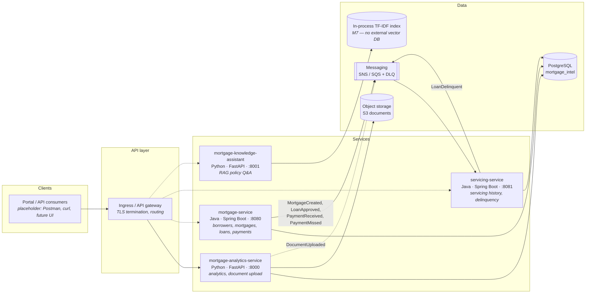

# Application Architecture

Logical components built over the 12 weeks and how they interact. Solid lines are built or planned for the next milestone; dashed lines are later milestones.

Solid lines are built; dashed are later milestones (M7 AI assistant, M9 gateway, M8 document-upload
events). Event flow detail: [event-catalog.md](./event-catalog.md), [ADR-002](../adr/ADR-002-microservice-decomposition.md).

## Components

| Component | Responsibility | Tech | Milestone |
| --- | --- | --- | --- |
| Portal / API consumers | Human and machine clients of the APIs | Postman, curl; UI optional | — |
| Ingress / API gateway | TLS termination, routing, rate limiting | ALB / API Gateway (AWS), local direct ports | M8–M9 |
| `mortgage-service` | Borrower, mortgage, loan, and payment write paths; publishes lifecycle events | Java 17, Spring Boot | **M4** |
| `servicing-service` | Servicing history and delinquency reads; consumes lifecycle events into `event_inbox`; publishes `LoanDelinquent` | Java 17, Spring Boot | **M4–M5** |
| `mortgage-analytics-service` | Normalization, portfolio analytics, document upload to S3 | Python, FastAPI, Pandas, boto3 | **M3** |
| `mortgage-knowledge-assistant` | Retrieval-augmented Q&A over policy documents | Python, FastAPI; TF-IDF + extractive generation by default, pluggable to a real OpenAI-compatible embeddings/LLM API | **M7** |
| PostgreSQL | System of record for transactional data | PostgreSQL 15+ | **M2** |
| Object storage | Document binaries | S3 (LocalStack/moto locally) | **M3** |
| Messaging | Asynchronous lifecycle events with DLQ | SNS/SQS (LocalStack locally, same code targets real AWS) | **M5** |

## Key design decisions (initial)

- **Shared database for M2+.** All services read the same `mortgage_intel` schema to keep early milestones simple; ownership of writes is documented per-table in [ADR-001](../adr/ADR-001-service-data-ownership.md) and the [service ownership matrix](./service-ownership-matrix.md), not by database-per-service.
- **Business IDs in APIs.** APIs use `MTG-####`/`BOR-###`, not internal UUIDs.
- **Correlation everywhere.** `X-Correlation-Id` flows HTTP → logs → events.
- **Analytics is read-only on core tables**, except the `document` table, which it writes on upload.
- **Events are at-least-once and best-effort** (M5). A dropped publish never fails the HTTP request that triggered it; consumers dedupe by `eventId` — see [ADR-002](../adr/ADR-002-microservice-decomposition.md).
