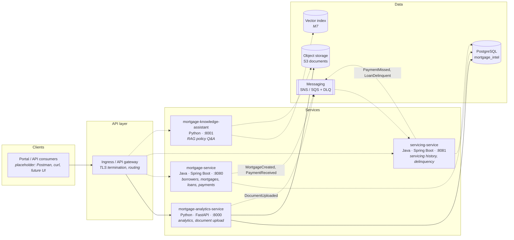

# Application Architecture

Logical components built over the 12 weeks and how they interact. Solid lines are built or planned for the next milestone; dashed lines are later milestones.

## Components

| Component | Responsibility | Tech | Milestone |
| --- | --- | --- | --- |
| Portal / API consumers | Human and machine clients of the APIs | Postman, curl; UI optional | — |
| Ingress / API gateway | TLS termination, routing, rate limiting | ALB / API Gateway (AWS), local direct ports | M8–M9 |
| `mortgage-service` | Borrower, mortgage, loan, and payment write paths; publishes lifecycle events | Java 17, Spring Boot | M4 |
| `servicing-service` | Servicing history and delinquency reads; consumes payment events; applies delinquency rule | Java 17, Spring Boot | M4–M5 |
| `mortgage-analytics-service` | Normalization, portfolio analytics, document upload to S3 | Python, FastAPI, Pandas, boto3 | **M3** |
| `mortgage-knowledge-assistant` | Retrieval-augmented Q&A over policy documents | Python, embeddings + LLM | M7 |
| PostgreSQL | System of record for transactional data | PostgreSQL 15+ | **M2** |
| Object storage | Document binaries | S3 (LocalStack/moto locally) | **M3** |
| Messaging | Asynchronous lifecycle events with DLQ | SNS/SQS | M5 |

## Key design decisions (initial)

- **Shared database for M2–M4.** All services read the same `mortgage_intel` schema to keep early milestones simple. Service-owned data and API-only access are revisited in M5 (record an ADR).
- **Business IDs in APIs.** APIs use `MTG-####`/`BOR-###`, not internal UUIDs.
- **Correlation everywhere.** `X-Correlation-Id` flows HTTP → logs → events.
- **Analytics is read-only on core tables**, except the `document` table, which it writes on upload.
