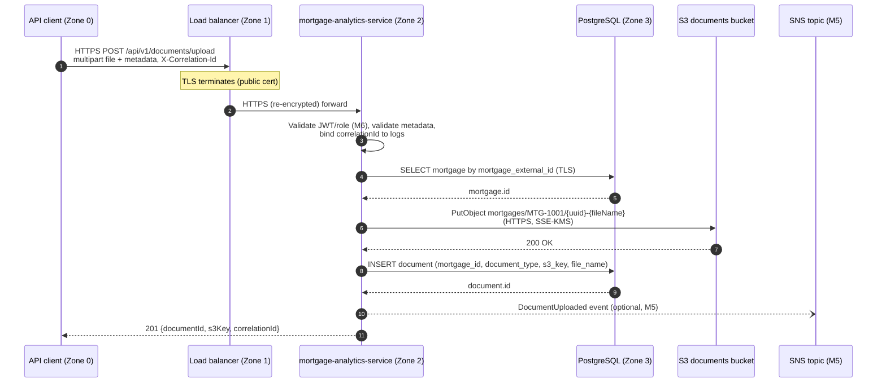

# Data Flow — Mortgage Document Upload

High-level trace of one path: **API client → API → database → cloud storage**, for an onboarding agent uploading an income verification document for `MTG-1001`. Implemented in M3 (`POST /api/v1/documents/upload`); hardened in M6 and M8.

## Where TLS terminates

| Hop | Transport |
| --- | --- |
| Client → load balancer | HTTPS; **public TLS terminates at the load balancer** |
| Load balancer → service | HTTPS re-encrypted with internal certificate |
| Service → PostgreSQL | TLS (`sslmode=require` in non-local environments) |
| Service → S3 / SNS | HTTPS through VPC endpoints; bucket policy denies non-TLS requests |

## Where PII is stored

| Data | Location | Protection |
| --- | --- | --- |
| Borrower name, email, phone, date of birth | PostgreSQL `borrower` table (Zone 3) | Encrypted at rest (RDS), least-privilege DB role, never logged |
| Document binaries (paystubs, IDs) | S3 bucket (private) | SSE-KMS, no public access, IAM-scoped access, keys include only business IDs |
| Document metadata (type, file name, S3 key) | PostgreSQL `document` table | Same as above; file names must not contain PII (e.g. `paystub-redacted.pdf`) |
| Logs | CloudWatch | Contain `correlationId` and business IDs only; no names, emails, tokens, or document contents |

## Failure handling

- S3 failure → service returns **502** with the standard error envelope; no `document` row is written.
- DB insert failure after S3 success → object is deleted (best effort) and the error is logged with the correlation ID.
- Unknown `mortgageExternalId` → **404** `MORTGAGE_NOT_FOUND` before anything is written to S3.
