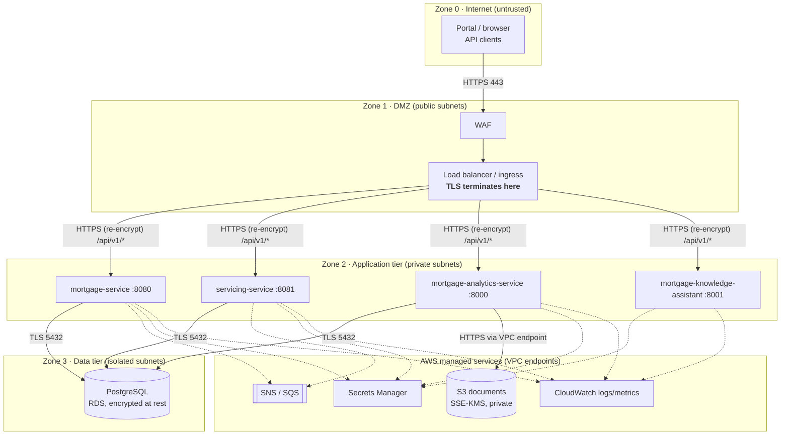

# Deployment Architecture

Environments, deployment topology, security zones, and trust boundaries. The topology targets AWS from M8; locally, the same components run as processes or containers on one workstation.

## Environments

| Environment | Purpose | Hosting | Data | Deploys from |
| --- | --- | --- | --- | --- |
| **dev** | Daily development and integration | Workstation + AWS sandbox (`capstone-mortgage-*-dev`) | Synthetic seed | `develop` (auto, from M9) |
| **test** | Integration, security, and E2E tests | AWS sandbox (`*-test`) | Synthetic seed, reset per run | `develop` (manual promote) |
| **prod** | Simulated production for final demo | AWS sandbox (`*-prod`) | Synthetic seed | `main` (tagged release, approval gate) |

All resources are tagged `Project=mortgage-intelligence`, `Environment=<env>`, `Team=<team>`.

## Topology and security zones

Legend: solid = built by M3 or required path; dashed = later milestone. Each zone box is a network segment; every arrow crossing a box edge crosses a **trust boundary**.

## Trust boundaries

| # | Boundary | Between | Controls |
| --- | --- | --- | --- |
| TB1 | Internet → DMZ | Clients and load balancer | HTTPS only (TLS 1.2+), WAF rules, rate limiting, only port 443 open |
| TB2 | DMZ → Application | Load balancer and services | Security group allows LB only; TLS re-encryption; JWT validation and RBAC in each service (M6); correlation ID assigned |
| TB3 | Application → Data | Services and PostgreSQL | DB in isolated subnet; security group allows app tier only on 5432; TLS; least-privilege `mortgage_app` role; credentials from Secrets Manager |
| TB4 | Application → AWS services | Services and S3/SNS/SQS | VPC endpoints (no internet path); IAM roles per service; S3 bucket private with SSE-KMS; bucket policy denies non-TLS |

Detailed controls per boundary: [trust-boundaries.md](./trust-boundaries.md). The STRIDE threat model is completed in M6.

## Request path (example)

1. A servicing agent's client calls `GET https://api.<env>.example.test/api/v1/mortgages/MTG-1001/servicing-history`.
2. **TB1:** WAF inspects; load balancer terminates TLS with the public certificate.
3. **TB2:** Load balancer forwards over TLS to `servicing-service`; service validates JWT, checks `SERVICING_AGENT` role, sets `X-Correlation-Id`.
4. **TB3:** Service queries PostgreSQL over TLS as `mortgage_app`.
5. Response returns the same path; logs ship to CloudWatch with the correlation ID.

## Local development topology

| Component | Local form |
| --- | --- |
| Portal / clients | curl, Postman, browser on `http://localhost` |
| Services | `uvicorn` / `mvn spring-boot:run` on ports 8000, 8001, 8080, 8081 |
| PostgreSQL | Local install or container on 5432 |
| S3 / SNS / SQS | LocalStack, or moto in tests |
| TLS | Not terminated locally (loopback only); never expose local ports publicly |
