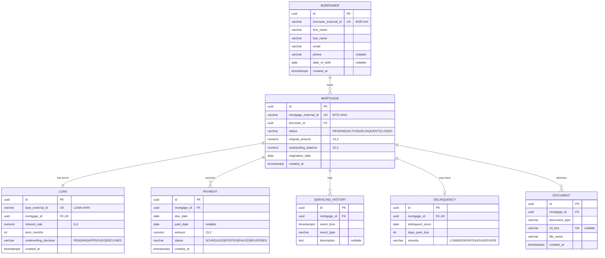

# Entity Relationship Diagram

Physical model implemented by [`database/migrations/001_core_schema.sql`](../../database/migrations/001_core_schema.sql). Column details, constraints, and indexes are in the [data dictionary](./data-dictionary.md). Aligned with the stages in [business-flow.md](../requirements/business-flow.md).

## Cardinality

| Relationship | Cardinality | Enforced by |
| --- | --- | --- |
| Borrower → Mortgage | 1 : 0..N | `mortgage.borrower_id` FK, NOT NULL |
| Mortgage → Loan | 1 : 1 | `loan.mortgage_id` FK, NOT NULL, UNIQUE |
| Mortgage → Payment | 1 : 0..N | `payment.mortgage_id` FK |
| Mortgage → ServicingHistory | 1 : 0..N | `servicing_history.mortgage_id` FK |
| Mortgage → Delinquency | 1 : 0..1 (current snapshot) | `delinquency.mortgage_id` FK, UNIQUE |
| Mortgage → Document | 1 : 0..N | `document.mortgage_id` FK |

## Lifecycle alignment

| Business flow stage | Tables |
| --- | --- |
| Borrower | `borrower` |
| Mortgage Onboarding | `mortgage` (`PENDING`), `document`, `servicing_history` (`APPLICATION_RECEIVED`) |
| Underwriting / Loan Approval | `loan.underwriting_decision`, `mortgage.status` → `ACTIVE` or `CLOSED` |
| Servicing | `servicing_history` |
| Payments | `payment`, `mortgage.outstanding_balance` |
| Delinquency | `payment` (unpaid installments) → `delinquency`, `mortgage.status = DELINQUENT` |
| Analytics & Reporting | Reads all of the above |

## Design notes

- **Loan vs. mortgage.** `mortgage` is the servicing unit (balance and status); `loan` holds the underwriting terms. They are 1:1 today; splitting them keeps underwriting changes out of the servicing record.
- **Delinquency is a snapshot**, not history. The servicing batch (M4) upserts the one row per delinquent mortgage and deletes it on cure. The history of status changes lives in `servicing_history`.
- **Business IDs** (`BOR-###`, `MTG-####`, `LOAN-####`) are UNIQUE with format CHECKs; APIs use them instead of UUIDs.
