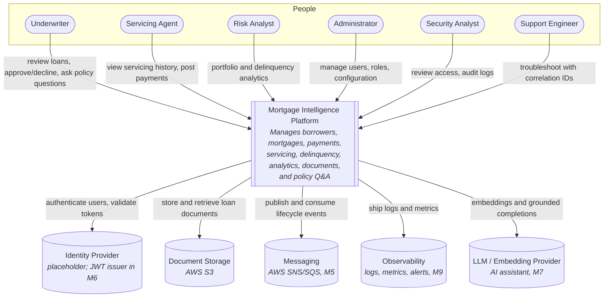

# System Context (C4 Level 1)

The Mortgage Intelligence Platform as a single system, the people who use it, and the external systems it depends on. Internal components are in [application-architecture.md](./application-architecture.md).

## Actors

| Actor | Interaction |
| --- | --- |
| Underwriter | Reviews loan terms and records underwriting decisions; asks the AI assistant policy questions. |
| Servicing Agent | Views mortgage status, payment history, servicing history; posts payments. |
| Risk Analyst | Reads portfolio summary, delinquency, borrower risk, and payment trends. |
| Administrator | Manages user accounts and roles; configures environments. |
| Security Analyst | Reviews access and audit logs; supports incidents. |
| Support Engineer | Uses health endpoints, logs, and dashboards to resolve failures. |

See [personas.md](../requirements/personas.md) for goals and pain points.

## External systems

| System | Purpose | Status |
| --- | --- | --- |
| Identity provider | Issues and validates user identity/tokens | Placeholder; service-issued JWT in M6 |
| Document storage (S3) | Holds document binaries; platform keeps metadata | M3 (upload), M8 (data platform) |
| Messaging (SNS/SQS) | Lifecycle events between services | M5 |
| Observability | Centralized logs, metrics, alerting | M9 |
| LLM / embeddings provider | Powers the AI assistant | M7 |

No real Fannie Mae, credit bureau, or payment network integrations are in scope (see [project-scope.md](../requirements/project-scope.md#out-of-scope)).
