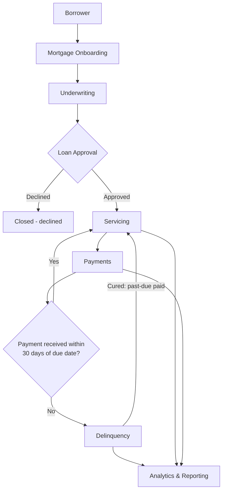

# Business Flow — Mortgage Lifecycle

The single agreed lifecycle used for demos, user stories, and end-to-end tests (M10). Stage names match the curriculum.

Mortgage status moves through `PENDING` → `ACTIVE` → (`DELINQUENT` ↔ `ACTIVE`) → `CLOSED`.

---

## Stage details

### 1. Borrower

- **Primary actor:** Borrower (Jamie); Servicing Agent or Underwriter enters data.
- **Inputs:** Name, email, phone, date of birth (synthetic).
- **Outputs:** Borrower record with business ID `BOR-###`.
- **Systems:** `mortgage-service` (M4) → `borrower` table.

### 2. Mortgage Onboarding

- **Primary actor:** Underwriter / onboarding operations.
- **Inputs:** Borrower ID, original amount, origination date, supporting documents.
- **Outputs:** Mortgage `MTG-####` with status `PENDING`; documents in S3 with metadata rows; `MortgageCreated` event.
- **Systems:** `mortgage-service` (M4), `mortgage-analytics-service` document upload (M3), S3, SNS (M5).

### 3. Underwriting

- **Primary actor:** Underwriter (Priya).
- **Inputs:** Mortgage and borrower details, loan terms (rate, term), policy guidance.
- **Outputs:** Loan record `LOAN-####` with `underwriting_decision` (`PENDING`/`APPROVED`/`DECLINED`).
- **Systems:** `mortgage-service` (M4), `mortgage-knowledge-assistant` for policy Q&A (M7).

### 4. Loan Approval

- **Primary actor:** Underwriter.
- **Inputs:** Underwriting decision.
- **Outputs:** Mortgage status `ACTIVE` when approved (or `CLOSED` when declined); `LoanApproved` event; servicing history entry `ONBOARDING_COMPLETE`.
- **Systems:** `mortgage-service` (M4), messaging (M5).

### 5. Servicing

- **Primary actor:** Servicing Agent (Marcus).
- **Inputs:** Lifecycle events, borrower contacts, status changes.
- **Outputs:** Chronological `servicing_history` entries; servicing history API.
- **Systems:** `servicing-service` (M4), event consumers (M5).

### 6. Payments

- **Primary actor:** Servicing Agent; Borrower as payer.
- **Inputs:** Scheduled payment (`due_date`, amount); posted payment (`paid_date`, amount, idempotency key).
- **Outputs:** `payment` rows (`SCHEDULED` → `POSTED`/`FAILED`/`REVERSED`); reduced `outstanding_balance`; `PaymentReceived` event.
- **Systems:** `mortgage-service` (M4), messaging (M5).

### 7. Delinquency (when payments are missed)

- **Primary actor:** System (batch rule); Servicing Agent and Risk Analyst consume results.
- **Inputs:** Scheduled payments past `due_date` with no successful posting.
- **Outputs:** After 30 days: mortgage status `DELINQUENT`, `delinquency` row (days past due, severity), `PaymentMissed` and `LoanDelinquent` events. When cured, status returns to `ACTIVE`.
- **Systems:** `servicing-service` (M4), messaging (M5), analytics (M3).

### 8. Analytics & Reporting

- **Primary actor:** Risk Analyst (Elena).
- **Inputs:** Mortgages, payments, delinquency snapshots.
- **Outputs:** Portfolio summary, delinquency rate, borrower risk summary, monthly payment trends; later, data lake reports.
- **Systems:** `mortgage-analytics-service` (M3), AWS data platform (M8).

---

## Delinquency rule (canonical)

1. A payment is due on each period's `due_date`.
2. If no successful payment posts within **30 calendar days** after `due_date`, the mortgage becomes **`DELINQUENT`**.
3. **Delinquency rate** = `count(DELINQUENT) / count(ACTIVE + DELINQUENT)`.
