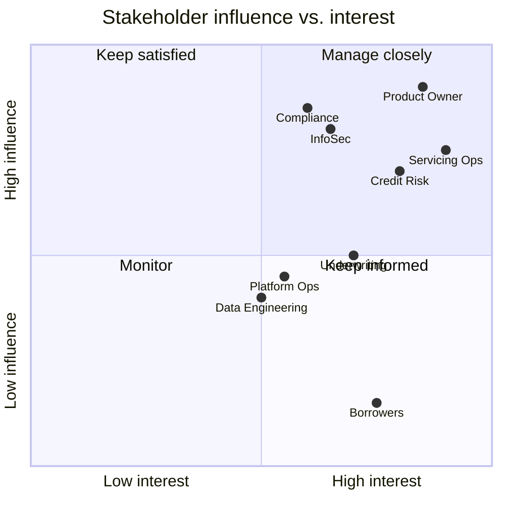

# Stakeholder Map

How each stakeholder group relates to the platform. Influence is relative to capstone decisions (High = can change scope or block a release).

| Stakeholder | Primary interest | Influence | Capstone touchpoint |
| --- | --- | --- | --- |
| Product Owner (instructor proxy) | Scope delivered on schedule; demo quality | High | Milestone reviews, backlog priority, sprint plans |
| Servicing Operations | Payment accuracy, complete loan history | High | Servicing APIs, payment posting, servicing history |
| Credit Risk | Early visibility into delinquency trends | High | Analytics service: portfolio summary, delinquency, borrower risk |
| Underwriting | Consistent decisions against policy | Medium | Loan/underwriting records, AI assistant policy Q&A |
| Compliance | Auditability, fair handling of borrower data | High | Correlation IDs, servicing audit trail, synthetic data rule, threat model |
| Information Security | Confidentiality and access control | High | Trust boundaries, JWT/RBAC, security tests, secret scanning |
| Platform Operations / SRE | Reliable deploys, fast troubleshooting | Medium | CI/CD, Terraform, dashboards, alerts, runbooks |
| Data & Analytics Engineering | Clean, reusable data | Medium | Schema, data dictionary, AWS data platform (M8) |
| Borrowers (indirect) | Correct balances, protected personal data | Low (indirect) | Data accuracy, PII controls |

## Influence / interest grid

## Engagement plan

- **Manage closely** (Product Owner, Servicing Ops, Credit Risk): demo at each milestone review; their acceptance criteria drive user stories.
- **Keep satisfied** (Compliance, InfoSec): review threat model and security controls in M6; sign off on the PII rule.
- **Keep informed** (Underwriting, Platform Ops, Data Engineering, Borrowers): README and architecture docs kept current; changes noted in PR descriptions.
